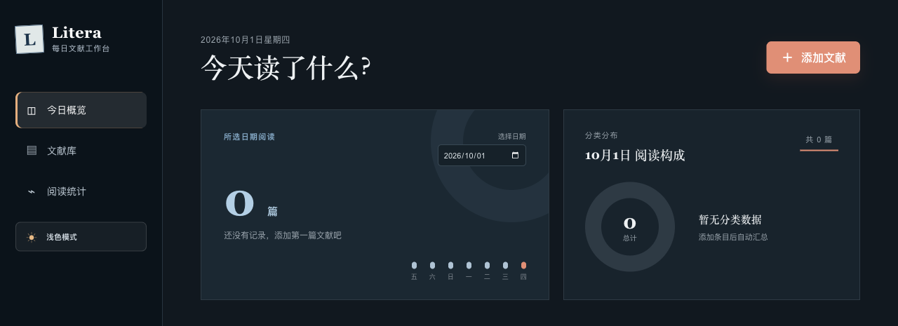
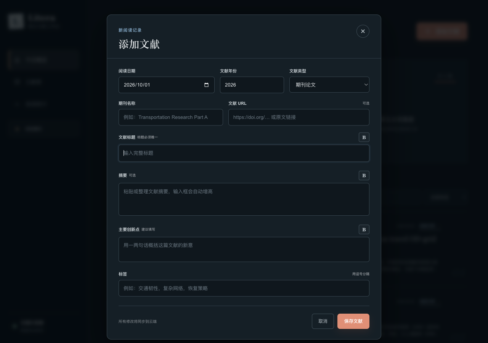

# Litera · 每日文献工作台

按阅读日期整理学术文献，集中保存摘要、创新点和标签，方便回顾每天的阅读与长期积累。对应原服务器的 8442 端口。

## 界面截图

概览图只展示不含个人阅读列表的上半部分；录入图为空白表单。

## 功能

- **每日概览**：选择阅读日期，查看当天的文献数量、近七日阅读趋势与类型分布。
- **文献录入**：记录阅读日期、文献年份与类型、期刊名称、原文链接和标题；可补充摘要、主要创新点与多个标签。
- **文献库**：按时间查看阅读记录，使用关键词搜索标题、标签或摘要，并按文献类型筛选。
- **详情与修改**：打开单篇文献查看完整笔记，对已有记录进行编辑；标题有唯一性校验。
- **阅读统计**：从阅读记录汇总趋势与分类信息；界面提供深浅色模式切换。
- **数据保存**：通过应用接口保存记录，并在界面显示连接与同步状态。

## 源码与数据

项目使用 React、TypeScript、Vinext、Drizzle 和 D1 兼容数据库接口。公开仓库不包含实际文献记录、数据库文件或访问密钥。

需要 Node.js 22.13.0 或更新版本。开发与构建命令：

    npm ci
    npm run dev
    npm run build

构建后的自托管入口：

    HOST=127.0.0.1 PORT=3102 node server.js

运行数据库相关功能前，需在部署环境中提供相应的数据库绑定或兼容适配器。
